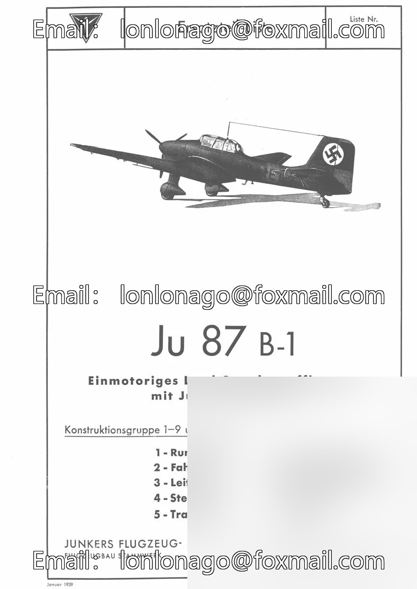
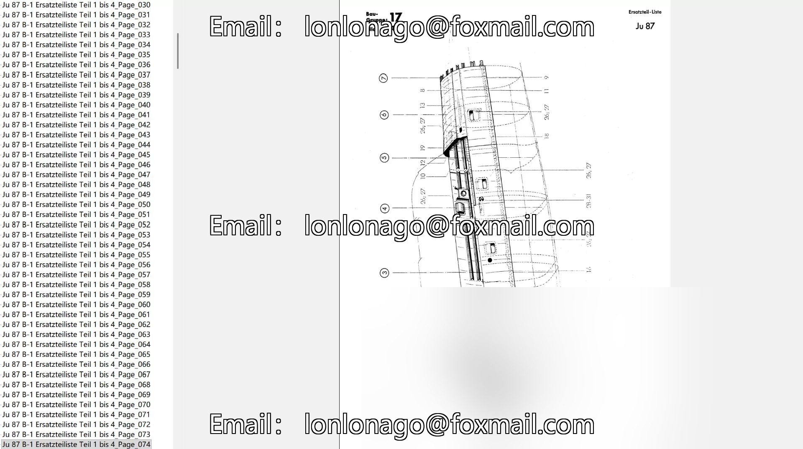
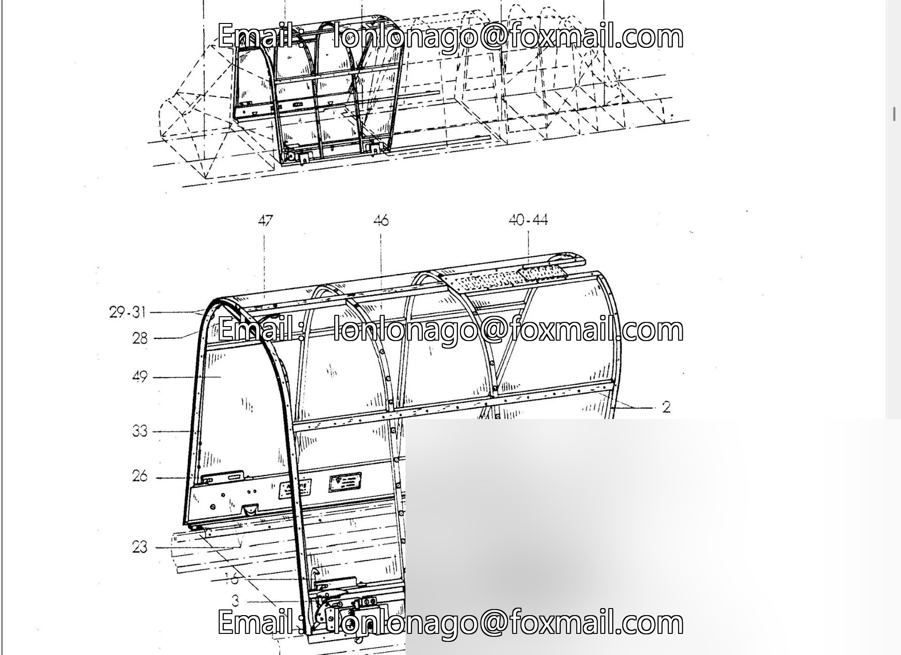
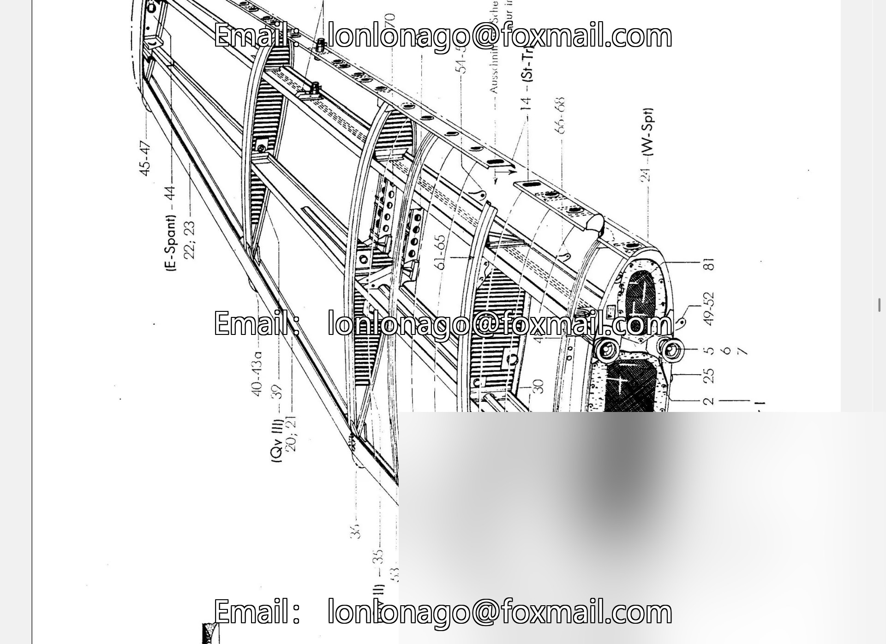
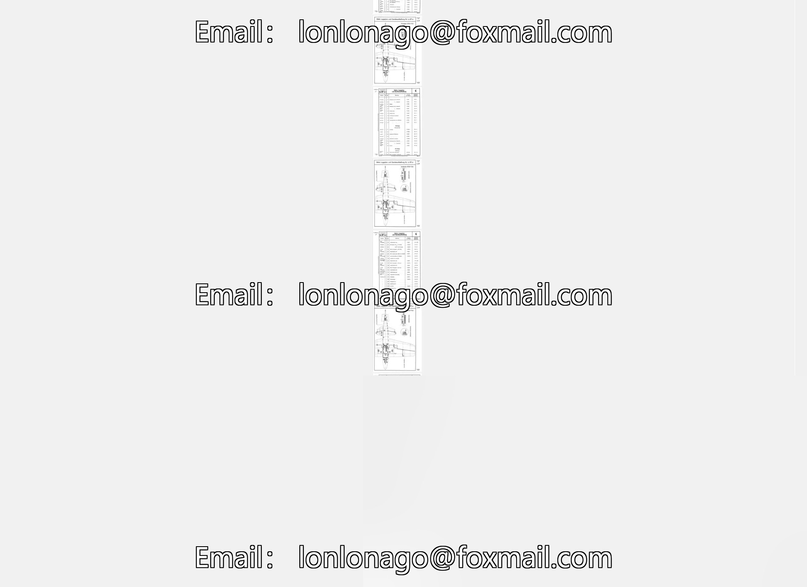

# Secondary World War German Ju 87 B-1 "Stuka" dive bomber , Ju

## Body

Electronic data of the Second World War German Ju 87 B-1 "Stuka" dive bomber, Jumo 211 A engine version,
approximately 560 pages.
Official original part drawings of JUNKERS, including detailed structure, systems, part numbering, etc., suitable for model verification and historical research.

PDF format, complete content, copyable.

Sales do not accept returns or exchanges.

The materials focus on the German WWII Ju 87 B-1 "Stuck" dive bomber, including the Jumo 211 A engine version, official part lists and structural details.

<!-- AI_ENRICHED -->

## Images

## Payment

Here is a pay link on Stripe ( https://buy.stripe.com/3cs8yP7sY87d0vu9AB ). Please contact me lonlonago@foxmail.com after funding $89, and I will send you a complete data files , thank you!

